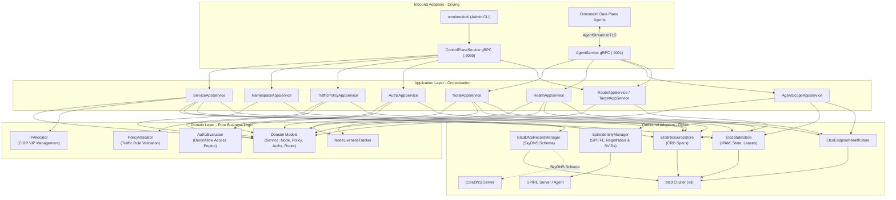

# Omnimesh Control Plane (`omnimeshcontrol`)

[](https://go.dev/)
[-purple)](#hexagonal-architecture)
[](#zero-trust-identity--security-spiffespire)
[](https://etcd.io/)
[](https://coredns.io/)

**Omnimesh Control Plane** (`omnimeshcontrol`) is a high-performance, modular control plane engineered for the **Omnimesh** service mesh. It coordinates service registration, dynamic mesh IP address management (IPAM), zero-trust SPIFFE/SPIRE identity attestation, bidirectional gRPC scope distribution to ambient data-plane proxies, multi-network locality routing, resilient traffic policies (retries, circuit breaking, rate limiting, load balancing), and automated SkyDNS/CoreDNS service discovery.

The codebase strictly adheres to **Hexagonal Architecture** (Ports & Adapters) and idiomatic Go design principles, ensuring zero infrastructure leakage into domain business logic.

---

## Table of Contents

- [Key Features](#key-features)
- [Architecture Overview](#architecture-overview)
  - [Hexagonal Architecture Layers](#hexagonal-architecture-layers)
  - [Component Architecture Diagram](#component-architecture-diagram)
  - [Dependency Rule](#dependency-rule)
- [Domain Concepts & Resource Model](#domain-concepts--resource-model)
  - [Custom Resource Definitions (CRDs)](#custom-resource-definitions-crds)
  - [Resource Specifications & YAML Examples](#resource-specifications--yaml-examples)
- [System Components & Subsystems](#system-components--subsystems)
  - [IPAM (IP Address Management)](#ipam-ip-address-management)
  - [Zero-Trust Identity & Security (SPIFFE/SPIRE)](#zero-trust-identity--security-spiffespire)
  - [Dual-Plane gRPC Streaming & Scope Distribution](#dual-plane-grpc-streaming--scope-distribution)
  - [Multi-Network Locality & Target Routing](#multi-network-locality--target-routing)
  - [Traffic Policies & Resilience](#traffic-policies--resilience)
  - [CoreDNS / SkyDNS Discovery](#coredns--skydns-discovery)
  - [Health Monitoring & Node Draining](#health-monitoring--node-draining)
- [Directory Layout](#directory-layout)
- [Getting Started](#getting-started)
  - [Prerequisites](#prerequisites)
  - [Building the Binaries](#building-the-binaries)
- [Local Development Environment](#local-development-environment)
  - [One-Command Dev Startup](#one-command-dev-startup)
  - [Individual Infrastructure Scripts](#individual-infrastructure-scripts)
- [Configuration & Environment Variables](#configuration--environment-variables)
- [CLI Reference (`omnimeshctl`)](#cli-reference-omnimeshctl)
- [gRPC Protocol Specifications](#grpc-protocol-specifications)
- [RFC Specifications](#rfc-specifications)
- [Testing & Quality Standards](#testing--quality-standards)
- [License](#license)

---

## Key Features

- 🌐 **Declarative Resource Engine**: Kubernetes-like declarative resource model (`core.omnimesh.io/v1`, `traffic.omnimesh.io/v1`, `policy.omnimesh.io/v1`) with atomic etcd v3 transactional persistence.
- 🎯 **Hexagonal Architecture**: Absolute separation of concerns between core domain logic, use-case application services, and external adapters (etcd, SPIRE, CoreDNS, gRPC).
- 🔒 **SPIFFE/SPIRE Zero-Trust Identity**: Automatic workload identity registration and mutual TLS (mTLS) enforcement with X.509 SVID rotation via the SPIRE Server Entry API and Agent Workload API.
- ⚡ **Real-Time Bidirectional gRPC Streaming**: Persistent streaming between data plane agents and the control plane for node registration, live health reporting, and incremental scope snapshot/update distribution.
- 🔢 **Dynamic IPAM**: Deterministic, collision-free mesh Virtual IP (VIP) allocation per namespace CIDR with atomic rollback and release.
- 🌍 **Multi-Network & Locality-Aware Routing**: Cross-cluster and cross-region traffic routing via `NetworkTarget` and weighted `TargetRoute` constructs for HBONE and gateway topologies.
- 🛡️ **Traffic Policy Enforcement**: Declarative configuration of exponential backoff retries, sliding-window circuit breakers, token-bucket rate limiters, outlier detection, and load balancing algorithms (Weighted Round-Robin, Least Connections, Random).
- 🏷️ **Authorization Policies**: Role-based and selector-driven authorization engine (`ALLOW` / `DENY`) enforcing default-deny access control policies across mesh workloads.
- 🔍 **Automated DNS Synthesis**: Real-time synchronization of mesh service VIPs into etcd SkyDNS records queried natively by CoreDNS.

---

## Architecture Overview

### Hexagonal Architecture Layers

The control plane follows strict Ports & Adapters design patterns:

```
github.com/esachser/omnimeshcontrol/
├── internal/
│   ├── domain/               # Core business logic (entities, value objects, domain services)
│   │   ├── model/            # Service, Namespace, Policy, Node, Route, Authz entities
│   │   └── service/          # IPAllocator, PolicyValidator, AuthzEvaluator, NodeTracker
│   │
│   ├── port/                 # Interface definitions (boundaries)
│   │   ├── inbound/          # Driving ports (ServiceManager, PolicyManager, NodeRegistrar, etc.)
│   │   └── outbound/         # Driven ports (ResourceStore, StateStore, DNSManager, IdentityManager, etc.)
│   │
│   ├── application/          # Orchestration layer (use case implementations)
│   │   ├── service/          # ServiceAppService, ServiceUpdateService
│   │   ├── namespace/        # NamespaceAppService
│   │   ├── policy/           # TrafficPolicyAppService, TrafficPolicyUpdateService
│   │   ├── authz/            # AuthzAppService, AuthzPolicyUpdateService
│   │   ├── node/             # NodeAppService, NodeUpdateService
│   │   ├── health/           # HealthAppService, HealthUpdateService
│   │   ├── route/            # RouteAppService, TargetAppService
│   │   └── scope/            # AgentScopeAppService
│   │
│   └── adapter/              # Concrete implementations of ports
│       ├── inbound/          # Driving adapters
│       │   └── grpcadapter/  # ControlPlaneServer (CLI/Admin) & AgentServer (Data Plane)
│       └── outbound/         # Driven adapters
│           ├── etcdstore/    # etcd v3 ResourceStore, StateStore, HealthStore, LivenessTracker
│           ├── etcddns/      # SkyDNS record manager for CoreDNS
│           ├── spire/        # SPIRE Server Entry API & Agent Workload API (mTLS)
│           └── routedist/    # gRPC route and scope distributor
```

### Component Architecture Diagram



### Dependency Rule

> **Dependencies always point inward.** The domain layer has zero external dependencies (no third-party frameworks, no transport protocols, no database drivers). Only Go standard library types are permitted in `internal/domain`.

```
Adapters ──► Application ──► Domain
Adapters ──► Ports
Application ──► Ports
Domain ──► (none)
```

---

## Domain Concepts & Resource Model

### Custom Resource Definitions (CRDs)

| Kind | API Version | Purpose |
| :--- | :--- | :--- |
| **`Namespace`** | `core.omnimesh.io/v1` | Logical isolation boundary, IPAM CIDR allocation pool, and policy scope. |
| **`Service`** | `core.omnimesh.io/v1` | Logical mesh service, target network, port/protocol, selectors, and mesh VIP. |
| **`NetworkTarget`** | `core.omnimesh.io/v1` | Declares an external or regional network cluster and its entry gateway address. |
| **`TargetRoute`** | `traffic.omnimesh.io/v1` | Defines locality routing weights, failover paths, and target cluster endpoints. |
| **`TrafficPolicy`** | `traffic.omnimesh.io/v1` | Configures resilience: retries, circuit breaking, rate limiting, load balancing, outlier detection. |
| **`AuthorizationPolicy`** | `policy.omnimesh.io/v1` | Defines identity-based access rules (`ALLOW` / `DENY`) between source and destination selectors. |

---

### Resource Specifications & YAML Examples

#### 1. Namespace (`namespace-production.yaml`)
```yaml
apiVersion: core.omnimesh.io/v1
kind: Namespace
metadata:
  name: production
  labels:
    environment: production
spec:
  isolation: strict
  cidr: 100.64.0.0/16
```

#### 2. Service (`service-payment.yaml`)
```yaml
apiVersion: core.omnimesh.io/v1
kind: Service
metadata:
  name: payment-service
  namespace: production
  labels:
    app: payment
    tier: backend
spec:
  target: us-east-1
  protocol: gRPC
  port: 50051
  selectors:
    - windows:process-name:payment-service.exe
    - unix:user:payment
```

#### 3. TrafficPolicy (`trafficpolicy-order.yaml`)
```yaml
apiVersion: traffic.omnimesh.io/v1
kind: TrafficPolicy
metadata:
  name: order-service-policy
  namespace: production
  labels:
    tier: backend
spec:
  targetService: production/order-service
  retry:
    maxRetries: 3
    retryOn:
      - connection-failure
      - 5xx
    backoffBase: 100ms
    backoffMax: 5s
  circuitBreaker:
    failureThreshold: 5
    failureWindow: 30s
    halfOpenAfter: 15s
    halfOpenMaxRequests: 1
    maxConcurrentRequests: 100
  rateLimiter:
    requestsPerSecond: 100.0
    burstSize: 150
    maxConcurrentRequests: 50
    limitExceededAction: reject
  loadBalancer:
    algorithm: weighted-round-robin
  outlierDetection:
    errorRateThreshold: 0.5
    minReportingAgents: 3
    ejectionDuration: 30s
    maxEjectionPercent: 50.0
```

#### 4. AuthorizationPolicy (`authz-order-to-payment.yaml`)
```yaml
apiVersion: policy.omnimesh.io/v1
kind: AuthorizationPolicy
metadata:
  name: order-to-payment
  namespace: production
spec:
  action: ALLOW
  source:
    namespace: production
    name: order-service
  destination:
    namespace: production
    name: payment-service
```

#### 5. NetworkTarget (`networktarget-us-east-1.yaml`)
```yaml
apiVersion: core.omnimesh.io/v1
kind: NetworkTarget
metadata:
  name: us-east-1
spec:
  gatewayAddress: "10.0.1.10:443"
```

#### 6. TargetRoute (`targetroute-payment.yaml`)
```yaml
apiVersion: traffic.omnimesh.io/v1
kind: TargetRoute
metadata:
  name: payment-route
  namespace: production
spec:
  target: us-east-1
  service: production/payment-service
  routes:
    - destination:
        target: us-east-1
        labels:
          region: us-east-1
      weight: 80
    - destination:
        target: eu-west-1
        labels:
          region: eu-west-1
      weight: 20
```

---

## System Components & Subsystems

### IPAM (IP Address Management)
- Automatically allocates unique Virtual IPs (VIPs) from the namespace CIDR (or the global mesh CIDR default `100.64.0.0/10`).
- Implemented via the `IPAllocator` domain service and persisted atomically in etcd using transactional Compare-and-Swap (`Txn`).
- Avoids collisions across concurrent control plane nodes.

### Zero-Trust Identity & Security (SPIFFE/SPIRE)
- Workload identity is modeled via SPIFFE IDs (e.g., `spiffe://omnimesh.local/ns/production/sa/payment-service`).
- When a `Service` is applied, `SpireIdentityManager` calls the SPIRE Server Entry API (`/spire.api.server.entry.v1.Entry/BatchCreateEntry`) to register the workload selectors.
- When `OMNIMESH_SPIRE_ENABLED=true`, the `AgentService` gRPC server enforces mTLS using X.509 SVIDs sourced dynamically from the SPIRE Agent Workload API.

### Dual-Plane gRPC Streaming & Scope Distribution
- **Port 9090 (`ControlPlaneService`)**: Admin/Operator API for CLI commands (`apply`, `get`, `delete`, `list`).
- **Port 9091 (`AgentService`)**: Bidirectional streaming endpoint (`AgentStream`).
  - **Agent ➔ Control Plane**: `RegisterNodeRequest`, `HealthReport`, `UpdateNodeServicesRequest`, `DrainNodeRequest`.
  - **Control Plane ➔ Agent**: `ScopeSnapshot` (complete configuration on connect) and `ScopeUpdate` (`ADD`, `MODIFY`, `REMOVE` events for services, routes, policies, health, and authorization).

### Multi-Network Locality & Target Routing
- Manages routing across distinct network zones (`NetworkTarget`).
- Allows data plane proxies to perform locality-aware load balancing and failover routing based on target weights and gateway addresses.

### Traffic Policies & Resilience
- Pure domain validation (`PolicyValidator`) verifies rule consistency (e.g., ensuring backoff limits are valid, protocols match HTTP/gRPC requirements, weights sum correctly).
- Pushes granular policy instructions to ambient sidecars to enforce circuit breakers, rate limits, and outlier ejections locally at wire speed.

### CoreDNS / SkyDNS Discovery
- Integrates seamlessly with CoreDNS by writing SkyDNS formatted key-values into etcd:
  `/skydns/local/omnimesh/<namespace>/<service_name>` ➔ `{"host":"<allocated_mesh_ip>","port":<service_port>}`
- CoreDNS queries for `<service>.<namespace>.omnimesh.local` resolve instantly to the assigned mesh VIP.

### Health Monitoring & Node Draining
- Agents stream active health probe outcomes (`TCP`, `HTTP`, `gRPC`) to the control plane.
- The control plane aggregates health states, ejects unhealthy endpoints from active routing snapshots, and facilitates graceful node draining before maintenance.

---

## Directory Layout

```
omnimeshcontrol/
├── api/
│   ├── proto/omnimesh/v1/          # Protobuf definitions (control.proto, agent.proto)
│   └── gen/omnimesh/v1/            # Generated Go gRPC & Protobuf bindings
├── bin/                            # Compiled binaries (omnimeshcontrol, omnimeshctl)
├── cmd/
│   ├── omnimeshcontrol/            # Control plane server entrypoint (main.go)
│   └── omnimeshctl/                # Control plane CLI entrypoint (commands/ root, apply, get, delete)
├── configs/                        # Component configs (Corefile, spire-server.conf, spire-agent.conf)
├── data/
│   ├── testresources/              # Sample YAML CRD resources for staging & testing
│   ├── spire-server/               # Dev SPIRE server data & sqlite storage
│   └── spire-agent/                # Dev SPIRE agent state & socket storage
├── internal/
│   ├── domain/                     # Domain Layer (Hexagonal core: models, pure services, errors)
│   ├── port/                       # Port interfaces (inbound & outbound contracts)
│   ├── application/                # Application Layer (use-case orchestration & update watchers)
│   ├── adapter/                    # Adapter Layer (etcd, spire, coredns, gRPC)
│   └── codec/                      # Serialization / deserialization helpers
├── rfcs/                           # Architecture RFCs and technical specifications
├── scripts/                        # PowerShell orchestration & component automation scripts
├── buf.yaml / buf.gen.yaml         # Buf configuration for Protobuf compilation
├── go.mod / go.sum                 # Go module definition and dependencies
├── CLAUDE.md                       # Engineering guidelines and architectural rules
└── README.md                       # Project documentation
```

---

## Getting Started

### Prerequisites

- **Go**: Version `1.26` or higher
- **etcd**: v3.5+ (available on `PATH` or in default ports)
- **SPIRE** (optional for local dev, recommended): `spire-server` and `spire-agent` v1.9+
- **CoreDNS** (optional for DNS queries): `coredns` v1.11+
- **PowerShell 5.1+** / **PowerShell Core 7+** (for Windows automation scripts)

---

### Building the Binaries

You can build both the control plane daemon and the CLI tool using standard Go toolchains:

```powershell
# Build the Control Plane Server
go build -o bin/omnimeshcontrol.exe ./cmd/omnimeshcontrol/

# Build the Omnimesh CLI
go build -o bin/omnimeshctl.exe ./cmd/omnimeshctl/
```

*On Linux / macOS:*
```bash
go build -o bin/omnimeshcontrol ./cmd/omnimeshcontrol/
go build -o bin/omnimeshctl ./cmd/omnimeshctl/
```

---

## Local Development Environment

The project includes pre-configured automation scripts in `scripts/` to launch all dependencies and the control plane with a single command.

### One-Command Dev Startup

Launch etcd, SPIRE server, SPIRE agent (with auto-generated join token and registered admin identity), CoreDNS, and the `omnimeshcontrol` server:

```powershell
.\scripts\start-dev-omm.ps1 -LogLevel info
```

To run with full debug logging:
```powershell
.\scripts\start-dev-omm.ps1 -LogLevel debug
```

To disable SPIRE identity registration for lightweight testing:
```powershell
.\scripts\start-dev-omm.ps1 -SpireEnabled $false
```

*Press `Enter` or `Ctrl+C` in the terminal to trigger clean, graceful shutdown of all background services.*

---

### Individual Infrastructure Scripts

If you prefer running components in dedicated terminals:

| Script | Command | Purpose |
| :--- | :--- | :--- |
| **Start Infrastructure** | `.\scripts\start-dev-env.ps1` | Launches etcd, SPIRE server/agent, and CoreDNS in background jobs. |
| **Standalone etcd** | `.\scripts\etcd-standalone.ps1` | Starts single-node etcd on `http://127.0.0.1:2379`. |
| **etcd Cluster** | `.\scripts\etcd-cluster.ps1` | Starts a 3-node local etcd cluster. |
| **SPIRE Server** | `.\scripts\spire-server.ps1` | Starts SPIRE server using `configs/spire-server.conf`. |
| **SPIRE Agent** | `.\scripts\spire-agent.ps1 -JoinToken <token>` | Attests and starts SPIRE agent using `configs/spire-agent.conf`. |
| **CoreDNS** | `.\scripts\coredns.ps1` | Starts CoreDNS with etcd plugin using `configs/Corefile`. |

---

## Configuration & Environment Variables

`omnimeshcontrol` is fully configured through environment variables:

| Variable | Default Value | Description |
| :--- | :--- | :--- |
| `OMNIMESH_GRPC_ADDR` | `:9090` | Listen address for the ControlPlane (CLI / Admin) gRPC API. |
| `OMNIMESH_AGENT_GRPC_ADDR` | `:9091` | Listen address for Data Plane Agent bidirectional streaming. |
| `OMNIMESH_MESH_CIDR` | `100.64.0.0/10` | Global default CIDR used for IPAM when namespaces omit one. |
| `OMNIMESH_DNS_ZONE` | `omnimesh.local` | Base DNS zone for SkyDNS / CoreDNS synthesis. |
| `OMNIMESH_ETCD_ENDPOINTS` | `http://localhost:2379` | Comma-separated list of etcd v3 client endpoints. |
| `OMNIMESH_ETCD_DIAL_TIMEOUT` | `5s` | Timeout duration for connecting to etcd. |
| `OMNIMESH_ETCD_TLS` | `false` | Enable TLS connection to etcd (`true`/`false`). |
| `OMNIMESH_ETCD_CA_CERT` | *(unset)* | Path to CA certificate for etcd TLS validation. |
| `OMNIMESH_ETCD_CERT` | *(unset)* | Path to client certificate for etcd mTLS. |
| `OMNIMESH_ETCD_KEY` | *(unset)* | Path to client private key for etcd mTLS. |
| `OMNIMESH_ETCD_USERNAME` | *(unset)* | Username for etcd basic authentication. |
| `OMNIMESH_ETCD_PASSWORD` | *(unset)* | Password for etcd basic authentication. |
| `OMNIMESH_SPIRE_ENABLED` | `false` | Enable SPIRE workload registration and agent mTLS verification. |
| `OMNIMESH_SPIRE_SERVER_ADDR` | `127.0.0.1:8081` | Address / Named Pipe / Unix Socket to SPIRE Server API. |
| `OMNIMESH_SPIRE_AGENT_ADDR` | `\\spire-agent\public\api` *(Win)*<br/>`unix:///tmp/...` *(Unix)* | Address to SPIRE Agent Workload API for fetching SVIDs. |
| `OMNIMESH_SPIRE_TRUST_DOMAIN`| `omnimesh.local` | SPIFFE trust domain name. |
| `OMNIMESH_SPIRE_PARENT_IDS` | `spiffe://omnimesh.local/agents/dev-agent` | Authorized parent SPIFFE IDs for workload registration. |
| `OMNIMESH_SPIRE_SELECTORS` | `windows:process-name:{{.Name}}.exe,unix:user:{{.Name}}` | Default templated workload attestation selectors. |

---

## CLI Reference (`omnimeshctl`)

`omnimeshctl` is the operator CLI used to manage resources in the control plane.

### Global Flags

```
  --server string       gRPC server address (default "localhost:9090", env: OMNIMESH_SERVER)
  -n, --namespace string   Namespace context (default "default")
  -h, --help            Help for omnimeshctl
```

### Commands

#### 1. Apply Resources (`apply`)
Creates or updates resources declaratively from YAML or JSON manifests:

```powershell
# Apply a namespace
.\bin\omnimeshctl apply -f data/testresources/namespace-production.yaml

# Apply a service
.\bin\omnimeshctl apply -f data/testresources/service-payment.yaml

# Apply traffic and authorization policies
.\bin\omnimeshctl apply -f data/testresources/trafficpolicy-payment.yaml
.\bin\omnimeshctl apply -f data/testresources/authz-order-to-payment.yaml
```

#### 2. Get / List Resources (`get`)
Retrieves one or more resources. Supports short aliases (`svc`, `ns`, `tp`, `target`, `route`):

```powershell
# List all namespaces
.\bin\omnimeshctl get namespace

# List all services in production namespace
.\bin\omnimeshctl get service -n production

# Get full JSON/YAML details for a specific service
.\bin\omnimeshctl get service payment-service -n production

# List traffic policies
.\bin\omnimeshctl get trafficpolicy -n production
```

#### 3. Delete Resources (`delete`)
Removes resources by kind and name:

```powershell
# Delete a service
.\bin\omnimeshctl delete service payment-service -n production

# Delete a namespace (fails if namespace contains active services unless forced)
.\bin\omnimeshctl delete namespace staging

# Force delete a namespace and cascade remove its contents
.\bin\omnimeshctl delete namespace staging --force
```

#### 4. Version (`version`)
Prints client version information:

```powershell
.\bin\omnimeshctl version
```

---

## gRPC Protocol Specifications

Protobuf files are located in `api/proto/omnimesh/v1/`:

### 1. `ControlPlaneService` (`control.proto`)
Synchronous unary RPCs for operator management:
- `rpc ApplyResource(ApplyResourceRequest) returns (ApplyResourceResponse)`
- `rpc GetResource(GetResourceRequest) returns (GetResourceResponse)`
- `rpc ListResources(ListResourcesRequest) returns (ListResourcesResponse)`
- `rpc DeleteResource(DeleteResourceRequest) returns (DeleteResourceResponse)`

### 2. `AgentService` (`agent.proto`)
Bidirectional long-lived streaming protocol:
- `rpc AgentStream(stream AgentStreamRequest) returns (stream AgentStreamResponse)`

#### Stream Messages:
- **`AgentStreamRequest`** (Agent ➔ Control Plane):
  - `RegisterNodeRequest`: Registers agent node ID, platform, HBONE address, labels, and local services.
  - `HealthReport`: Reports endpoint health status (`HEALTHY`, `UNHEALTHY`, `DRAINING`) and probe type (`TCP`, `HTTP`, `gRPC`).
  - `UpdateNodeServicesRequest`: Dynamic addition or removal of local services on the node.
  - `DrainNodeRequest`: Initiates graceful node shutdown and route retraction.
- **`AgentStreamResponse`** (Control Plane ➔ Agent):
  - `ScopeSnapshot`: Complete snapshot of relevant services, routes, traffic policies, authz policies, and endpoint health states.
  - `ScopeUpdate`: Incremental delta update (`ADD`, `MODIFY`, `REMOVE`).

---

## RFC Specifications

Detailed architectural designs and design decisions are documented under the `rfcs/` directory:

- [RFC-0001: Omnimesh Control Plane — Initial Architecture](rfcs/rfc-0001-initial-design.md)
- [RFC-0002: High Availability & State Storage — Embedded etcd](rfcs/rfc-0002-high-availability.md)
- [RFC-0003: Traffic Policies — Retries, Circuit Breaking, Rate Limiting & Load Balancing](rfcs/rfc-0003-traffic-policies.md)
- [RFC-0004: Authorization Policies — SPIFFE Identity-Based Access Control](rfcs/rfc-0004-authorization.md)
- [RFC-0005: Observability — OpenTelemetry Metrics, Traces & Logs](rfcs/rfc-0005-observability.md)
- [RFC-0006: Multi-Network Routing and Locality](rfcs/rfc-0006-multi-network-routing.md)

---

## Testing & Quality Standards

- **Hexagonal Integrity**: Domain logic has **zero external imports**.
- **Table-Driven Tests**: All unit tests in domain and application layers use table-driven test patterns.
- **Concurrency Safety**: Background update watchers utilize `context.Context` cancellation and thread-safe channels.

Run unit tests across all packages:

```powershell
go test ./internal/domain/...
go test ./internal/application/...
go test ./internal/adapter/...
```

Run code formatting and verification:
```powershell
gofmt -s -w .
go vet ./...
```

---

## License

This project is licensed under the terms specified in the [LICENSE](LICENSE) file.
