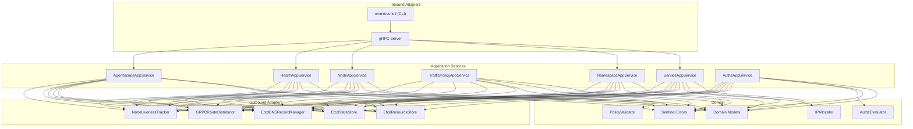

# Omnimesh Control Plane — Implementation Walkthrough

All **5 phases complete**. `go build ./...` succeeds, all tests pass.

## Architecture



## Phase Summary

### Phase 1: Domain Layer (9 models, 3 services, 1 errors, 11 ports)

| Layer | Files |
|---|---|
| Models | [resource.go](file:///c:/Users/eduar/repos/go-projects/omnimeshcontrol/internal/domain/model/resource.go), [service.go](file:///c:/Users/eduar/repos/go-projects/omnimeshcontrol/internal/domain/model/service.go), [namespace.go](file:///c:/Users/eduar/repos/go-projects/omnimeshcontrol/internal/domain/model/namespace.go), [node.go](file:///c:/Users/eduar/repos/go-projects/omnimeshcontrol/internal/domain/model/node.go), [route.go](file:///c:/Users/eduar/repos/go-projects/omnimeshcontrol/internal/domain/model/route.go), [policy.go](file:///c:/Users/eduar/repos/go-projects/omnimeshcontrol/internal/domain/model/policy.go), [authz.go](file:///c:/Users/eduar/repos/go-projects/omnimeshcontrol/internal/domain/model/authz.go), [health.go](file:///c:/Users/eduar/repos/go-projects/omnimeshcontrol/internal/domain/model/health.go), [identity.go](file:///c:/Users/eduar/repos/go-projects/omnimeshcontrol/internal/domain/model/identity.go) |
| Errors | [errors.go](file:///c:/Users/eduar/repos/go-projects/omnimeshcontrol/internal/domain/errors.go) |
| Services | [ip_allocator.go](file:///c:/Users/eduar/repos/go-projects/omnimeshcontrol/internal/domain/service/ip_allocator.go), [policy_validator.go](file:///c:/Users/eduar/repos/go-projects/omnimeshcontrol/internal/domain/service/policy_validator.go), [authz_evaluator.go](file:///c:/Users/eduar/repos/go-projects/omnimeshcontrol/internal/domain/service/authz_evaluator.go) |
| Outbound Ports | [resource_store.go](file:///c:/Users/eduar/repos/go-projects/omnimeshcontrol/internal/port/outbound/resource_store.go), [state_store.go](file:///c:/Users/eduar/repos/go-projects/omnimeshcontrol/internal/port/outbound/state_store.go), [dns.go](file:///c:/Users/eduar/repos/go-projects/omnimeshcontrol/internal/port/outbound/dns.go), [route_distributor.go](file:///c:/Users/eduar/repos/go-projects/omnimeshcontrol/internal/port/outbound/route_distributor.go), [identity.go](file:///c:/Users/eduar/repos/go-projects/omnimeshcontrol/internal/port/outbound/identity.go), [traffic_policy_store.go](file:///c:/Users/eduar/repos/go-projects/omnimeshcontrol/internal/port/outbound/traffic_policy_store.go) |
| Inbound Ports | [service_manager.go](file:///c:/Users/eduar/repos/go-projects/omnimeshcontrol/internal/port/inbound/service_manager.go), [namespace_manager.go](file:///c:/Users/eduar/repos/go-projects/omnimeshcontrol/internal/port/inbound/namespace_manager.go), [node_registrar.go](file:///c:/Users/eduar/repos/go-projects/omnimeshcontrol/internal/port/inbound/node_registrar.go), [policy_manager.go](file:///c:/Users/eduar/repos/go-projects/omnimeshcontrol/internal/port/inbound/policy_manager.go), [authz_manager.go](file:///c:/Users/eduar/repos/go-projects/omnimeshcontrol/internal/port/inbound/authz_manager.go) |

---

### Phase 2: Embedded etcd & Outbound Adapters (6 source + 3 test files)

| Adapter | File | Key Feature |
|---|---|---|
| Embedded etcd | [embed.go](file:///c:/Users/eduar/repos/go-projects/omnimeshcontrol/internal/adapter/outbound/etcdstore/embed.go) | Start/stop, readiness wait |
| ResourceStore | [resource_store.go](file:///c:/Users/eduar/repos/go-projects/omnimeshcontrol/internal/adapter/outbound/etcdstore/resource_store.go) | CRUD + Watch + CompareAndPut (optimistic concurrency) |
| StateStore | [state_store.go](file:///c:/Users/eduar/repos/go-projects/omnimeshcontrol/internal/adapter/outbound/etcdstore/state_store.go) | Atomic IP alloc via Txn, leader election |
| Liveness | [node_tracker.go](file:///c:/Users/eduar/repos/go-projects/omnimeshcontrol/internal/adapter/outbound/etcdstore/node_tracker.go) | In-memory grace period timers |
| DNS | [dns_adapter.go](file:///c:/Users/eduar/repos/go-projects/omnimeshcontrol/internal/adapter/outbound/etcddns/dns_adapter.go) | SkyDNS keys for CoreDNS |
| Routes | [grpc_push.go](file:///c:/Users/eduar/repos/go-projects/omnimeshcontrol/internal/adapter/outbound/routedist/grpc_push.go) | In-memory MVP |

---

### Phase 3: Application Services (9 source + 6 test files)

| Service | File | Key Flow |
|---|---|---|
| ServiceAppService | [service_app.go](file:///c:/Users/eduar/repos/go-projects/omnimeshcontrol/internal/application/service_app.go) | validate → namespace check → IP alloc → identity → persist → DNS → route |
| NamespaceAppService | [namespace_app.go](file:///c:/Users/eduar/repos/go-projects/omnimeshcontrol/internal/application/namespace_app.go) | CRUD + non-empty delete protection |
| NodeAppService | [node_app.go](file:///c:/Users/eduar/repos/go-projects/omnimeshcontrol/internal/application/node_app.go) | Persist + track liveness |
| TrafficPolicyAppService | [policy_app.go](file:///c:/Users/eduar/repos/go-projects/omnimeshcontrol/internal/application/policy_app.go) | Protocol validation + conflict detect |
| AuthzAppService | [authz_app.go](file:///c:/Users/eduar/repos/go-projects/omnimeshcontrol/internal/application/authz_app.go) | DENY→ALLOW→default-DENY evaluation |
| HealthAppService | [health_app.go](file:///c:/Users/eduar/repos/go-projects/omnimeshcontrol/internal/application/health_app.go) | Health reports + drain initiation |
| AgentScopeAppService | [scope_app.go](file:///c:/Users/eduar/repos/go-projects/omnimeshcontrol/internal/application/scope_app.go) | Aggregate scope for agents |

---

### Phase 4: gRPC Inbound Adapter (2 proto + 4 generated + 2 server + 1 main)

| Component | File |
|---|---|
| Proto | [control.proto](file:///c:/Users/eduar/repos/go-projects/omnimeshcontrol/api/proto/omnimesh/v1/control.proto), [agent.proto](file:///c:/Users/eduar/repos/go-projects/omnimeshcontrol/api/proto/omnimesh/v1/agent.proto) |
| ControlPlane gRPC | [control_server.go](file:///c:/Users/eduar/repos/go-projects/omnimeshcontrol/internal/adapter/inbound/grpcadapter/control_server.go) |
| Agent gRPC | [agent_server.go](file:///c:/Users/eduar/repos/go-projects/omnimeshcontrol/internal/adapter/inbound/grpcadapter/agent_server.go) |
| Main wiring | [main.go](file:///c:/Users/eduar/repos/go-projects/omnimeshcontrol/cmd/omnimeshcontrol/main.go) |

---

### Phase 5: CLI (6 files)

| Command | File |
|---|---|
| main | [main.go](file:///c:/Users/eduar/repos/go-projects/omnimeshcontrol/cmd/omnimeshctl/main.go) |
| apply | [apply.go](file:///c:/Users/eduar/repos/go-projects/omnimeshcontrol/cmd/omnimeshctl/commands/apply.go) |
| get | [get.go](file:///c:/Users/eduar/repos/go-projects/omnimeshcontrol/cmd/omnimeshctl/commands/get.go) |
| delete | [delete.go](file:///c:/Users/eduar/repos/go-projects/omnimeshcontrol/cmd/omnimeshctl/commands/delete.go) |
| version | [version.go](file:///c:/Users/eduar/repos/go-projects/omnimeshcontrol/cmd/omnimeshctl/commands/version.go) |

## Verification

```
go build ./...           → BUILD OK
go test ./internal/...   → ALL TESTS PASS
```
